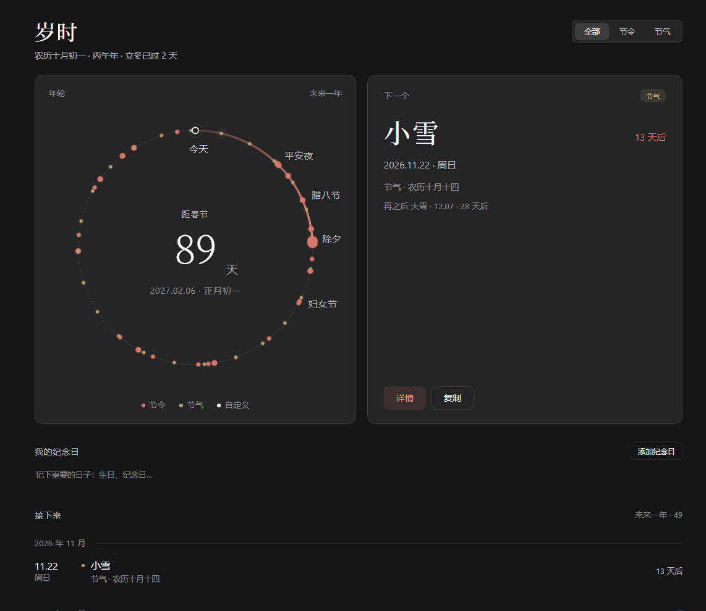
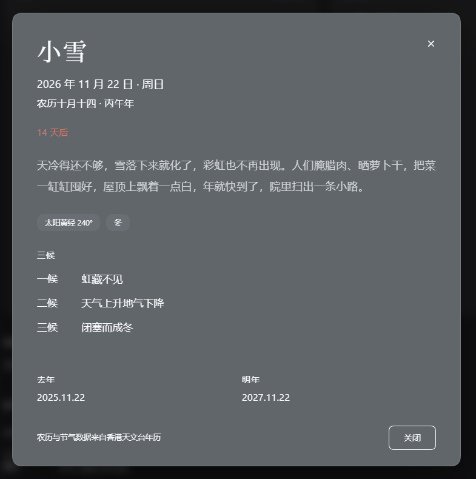

# 岁时 (Suishi) — DSH Web 插件

中国年 · 全年节日倒计时。一枚安静的中国年历：农历、二十四节气、自定义纪念日，
以及一个常驻侧栏的「距春节」小胶囊。



## 功能

- **主面板**（侧栏「岁时」图标 / 侧栏胶囊进入）：农历副标、全部/节令/节气筛选、
  年轮盘（未来一年节点 + 春节倒计时 + 少数节令标注）、「下一个」节点卡、
  我的纪念日、接下来一年的分组列表。
- **详情弹层**：节气三候 / 太阳黄经 / 季节，节令释义 / 别名 / 习俗，去年与明年日期。
- **自定义纪念日**：农历或公历、每年重复，保存后立即进入年轮、列表与提醒。
- **侧栏胶囊**：宽 / 窄（rail）两态，实时显示距下一个春节的天数。
- **设置页**：安静提醒开关与提前天数、侧栏胶囊开关、纪念日管理。
- **安静提醒**：重要日子临近时，右下角出现一张不打扰的提醒卡（每天一次）。
- **跨天刷新**：页面停留过夜会自动把「今天」推进到新的一天。



## 数据

农历与二十四节气离线数据由**香港天文台 1901–2100 年公众日历**在构建期生成，
运行时不联网。数据文件为 `src/parts/10-cal-data.js`（约 27 KB），随插件一起发布。

重新生成与校验（在仓库根目录执行）：

```bash
node tools/hko/fetch.mjs          # 下载原始年表到 tools/hko/raw/（已存在则跳过）
node tools/hko/build-calendar.mjs # 解析并生成 src/parts/10-cal-data.js
node tests/test-lunar.mjs         # 逐日比对 1901-01-01 ~ 2100-12-31
node tests/test-festivals.mjs     # 24 节气 + 25 节令的文案数据校验
```

数据来源：香港天文台《1901–2100 年公历与农历日期对照表》，
<https://www.hko.gov.hk/tc/gts/time/conversion.htm>。政府公开资料，按原样使用，
插件详情弹层底部也标注了数据来源。原始年表（约 5.6 MB）不入库，只保留生成脚本。

## 安装

前置：本机已安装 DSH（`dsh` 命令可用）。把仓库克隆到任意目录：

```bash
git clone https://github.com/qianniu2009/dsh-suishi.git
```

然后在 DSH 会话里用插件管理安装该目录的**绝对路径**：

```
plugin_manager(action: "install_bundle", target: "<克隆目录的绝对路径>")
```

安装后刷新 DSH Web 页面：侧栏出现「岁时」图标，侧栏底部出现「距春节 N 天」胶囊，
设置面板多出「岁时」分区。

> 也可以把本目录复制到 DSH 工作区后安装；插件通过 `link:` 方式挂到 profile，
> 目录移动后需要重新安装。

## 开发

二次开发（新增功能、改数据、发布版本）见 [DEVELOPING.md](DEVELOPING.md)。

## 构建

插件是一个纯 JavaScript 的 DSH bundle：Host half（`index.js`）为空实现，所有界面与
数据都在浏览器端。`client.js` 由 `build.mjs` 把 `src/parts/*.js` 按文件名顺序拼进
DSH 的 `window.__ModuleLoader__` 包装而成，无 npm 依赖、无构建工具链：

```bash
node build.mjs          # 生成 client.js
node build.mjs --check  # 仅语法检查
```

仓库内已提交构建产物 `client.js`，安装时无需再构建。

## 验证状态

- 构建与数据自检（全部通过）：

  ```bash
  node build.mjs --check        # OK 17 parts
  node tests/run-node.mjs       # 状态/事件/格式化等逻辑检查
  node tests/test-lunar.mjs     # 73,049 天逐日比对 HKO，19/19
  node tests/test-festivals.mjs # 24 节气 + 25 节令，888 项断言
  ```

- 浏览器实测（DSH Web 1440×1120，深色 / 浅色主题）：主面板、三档筛选、年轮盘与
  高亮弧、「下一个」卡、我的纪念日、接下来列表、详情弹层（Esc / 遮罩 / × 三种关闭）、
  添加纪念日完整闭环、设置分区、侧栏胶囊 wide/rail 两态、安静提醒、跨天自动刷新
  均通过；控制台无报错。
- 已知限制：年轮盘相对卡片的比例与原始设计稿有 1–2% 级差异；卡片宽度会随宿主
  内容区宽度变化；安静提醒固定在右下角，可能与其他插件浮层视觉重叠。

## 目录

```
.
├── package.json          bundle 清单（dsh.bundle.patch + dsh.client）
├── cordis.patch.yml      插入插件行
├── index.js              Host half（空实现）
├── client.js             构建产物（由 build.mjs 生成，勿手改）
├── icon.svg              插件图标
├── locale/               插件管理器的标题/描述（中/英）
├── build.mjs             拼接式构建脚本
├── src/parts/            客户端源码分片（按序拼进一个 factory 作用域）
│   ├── 00-core.js        SS 基础设施、i18n、图标、公共组件、弹层
│   ├── 10/11-*.js        香港天文台农历/节气数据与农历引擎
│   ├── 20-festivals.js   二十四节气 + 25 个节令的文案数据
│   ├── 30-store.js       状态快照 / 事件模型 / 持久化 / 跨天
│   ├── 35-base.js        设计变量与页面骨架样式
│   ├── 40-ring.js        年轮盘
│   ├── 45/50/55-*.js     下一个卡 / 我的纪念日 / 接下来列表
│   ├── 60/65/70/75/80-*  详情弹层 / 添加纪念日 / 设置页 / 侧栏胶囊 / 提醒
│   └── 85/90-*.js        页面组装 / 槽位注册
├── tools/hko/            数据抓取与生成（原始年表不入库）
├── tests/                数据与逻辑自检
└── docs/                 README 截图
```

## 设计

- 颜色：跟随 DSH 主题 token（`--dsw-alias-*`，深 / 浅色自动适配），插件自有朱砂
  `#d97768`（节令 / 强调）、赭金 `#b99c6b`（节气）、象牙白 `#f2efe9`（自定义）。
- 字体：标题与倒计时数字使用宋体字族（Noto Serif SC / 思源宋体 / 宋体）。
- 交互：年轮点、列表行可点开详情；Esc / 遮罩关闭弹层；设置开关带 `aria-checked`。
- 实现：单个浏览器模块（`client.js`，约 187 KB），无运行时网络请求。

## License

代码以 [MIT License](LICENSE) 发布，Copyright (c) 2026 qianniu2009。

农历/节气数据来自香港天文台公开年历（香港特别行政区政府资料），按其原发布条款使用，
版权归原发布方；仓库中仅包含构建期据此生成的派生数据。
